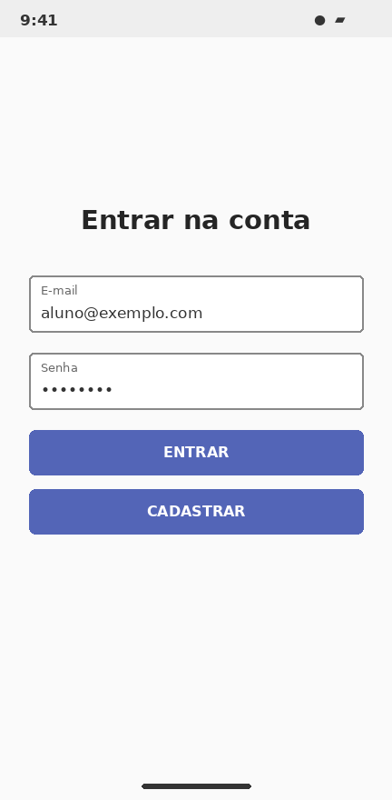
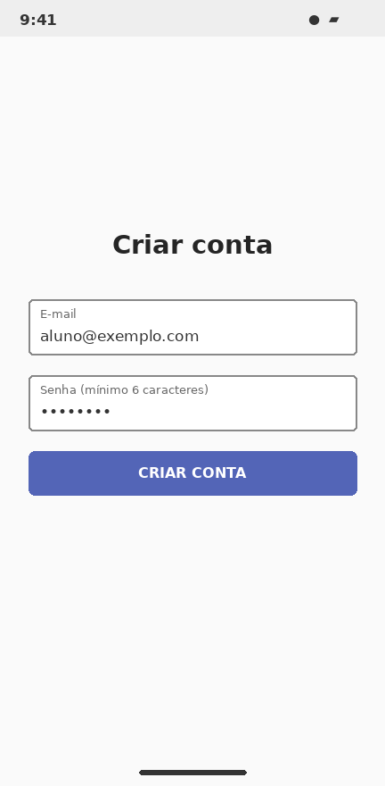

# TP07 — Autenticação com Firebase em Kotlin

Projeto desenvolvido para a atividade de **Desenvolvimento para Dispositivos Móveis**. O objetivo é criar um aplicativo Android com autenticação por e-mail e senha usando Firebase Authentication.

## O que o aplicativo faz

- **Entrar:** permite acessar uma conta já cadastrada.
- **Cadastrar:** cria um novo usuário informando e-mail e senha.
- **Meu perfil:** apresenta o e-mail da conta conectada.
- **Sair:** encerra a sessão e retorna à tela de login.

## Tecnologias utilizadas

- Kotlin
- Android Studio
- XML para as telas
- Firebase Authentication

## Prévia das telas

As imagens abaixo são **ilustrações das interfaces previstas no código**, não capturas do aplicativo em execução. Após configurar o Firebase e rodar o projeto, elas podem ser substituídas por prints reais.

| Login | Cadastro | Meu perfil |
|:---:|:---:|:---:|
|  |  |  |

## Como configurar

1. Abra o projeto no Android Studio.
2. Crie um projeto no [Firebase Console](https://console.firebase.google.com/).
3. Cadastre o aplicativo Android com o pacote `com.exemplo.firebaseauth`.
4. Baixe o arquivo `google-services.json` e coloque na pasta `app/`.
5. Em **Authentication > Sign-in method**, habilite **E-mail/senha**.
6. Sincronize o Gradle e execute no emulador ou celular.

## Observação

O arquivo `google-services.json` não acompanha este projeto porque é gerado para cada aplicativo no Firebase. Este pacote também não inclui o `gradle-wrapper.jar`. Caso o Android Studio precise dele, crie um projeto Android com Kotlin e Views/XML e utilize o wrapper gerado pelo Android Studio. O aplicativo ainda precisa ser compilado e testado em um dispositivo ou emulador.
